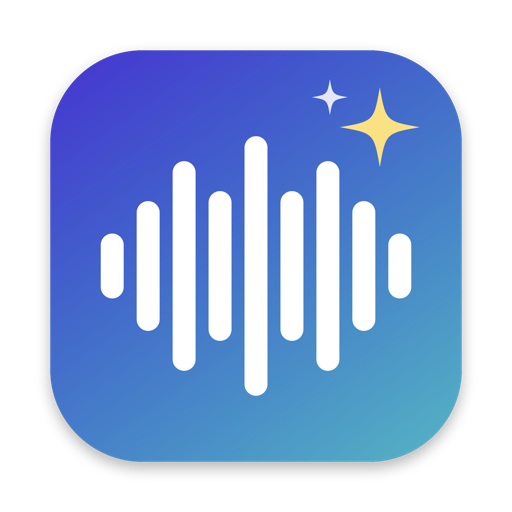

<p align="center"></p>

# Eco

App para Mac que escucha tus llamadas (Zoom, Meet, Teams, FaceTime…) sin meter un bot, las transcribe y hace notas con IA. Todo en tu Mac: usa la IA que ya trae macOS y nada sale a la nube.

## Qué hace

- **Graba** tu micrófono y el audio del sistema (la otra parte de la llamada) con ScreenCaptureKit.
- **Transcribe en vivo** con `SpeechAnalyzer`, en el propio Mac.
- **Separa a las personas por su voz** (Persona 1, 2…), tanto en la llamada como en tu sala, con [FluidAudio](https://github.com/FluidInference/FluidAudio) en local. Les pone nombre con los invitados del calendario.
- **Resume** con Apple Intelligence (`FoundationModels`): resumen, puntos clave, decisiones y próximos pasos.
- **Amplía tus notas**: escribes notas cortas durante la llamada y la IA añade los detalles debajo, en gris.
- **Chat**: pregúntale a todas tus reuniones o solo a una («¿qué pendientes tengo?»), con fuentes.
- **Calendario**: conoce la reunión en curso, sus invitados y las próximas del día.
- **Automático**: avisa cuando empieza una reunión y se detiene sola cuando cuelgas.
- **Notas de Apple**: envía cada llamada a la carpeta «Eco» y la mantiene actualizada.
- Icono en la barra de menús y ventanita flotante mientras grabas.

## Requisitos

- macOS 26 o posterior, en un Mac con Apple silicon
- Apple Intelligence activado (para resúmenes, notas y chat)
- Xcode 26 o posterior

## Compilar

```bash
./build.sh
open Eco.app
```

`build.sh` compila el Swift Package, arma `Eco.app` y la firma con tu certificado «Apple Development» si lo tienes. Si no, la firma ad hoc. Con un certificado fijo, macOS recuerda los permisos entre compilaciones. Para usar otro certificado, ponlo en `ECO_SIGN`.

La primera vez macOS pide permiso de micrófono, grabación de pantalla y audio del sistema, Calendario y control de Notas. El modelo de voz de Apple y el de separación de voces se descargan solos la primera vez.

Pruebas internas, sin interfaz:

```bash
Eco.app/Contents/MacOS/Eco --selftest
```

## Dónde se guarda

- Historial: `~/Library/Application Support/Eco/` (un JSON por llamada)
- El audio se borra al terminar cada llamada; solo se guarda el texto.

## Estructura

| Archivo | Qué contiene |
|---|---|
| `Sources/Eco/Eco.swift` | App, barra de menús e interfaz (inicio, grabación, nota) |
| `Sources/Eco/Engine.swift` | Captura, transcripción, voces, resumen, notas ampliadas, historial y Notas de Apple |
| `Sources/Eco/Meeting.swift` | Calendario, detección de inicio y fin de llamadas, ventanita flotante |
| `Sources/Eco/Chat.swift` | Búsqueda de fragmentos y chat con tus reuniones |
| `icon.swift` | Dibuja el icono (`Eco.icns`) |
